# system-integration

**MachinakaRestaurantSupportTools** 全体のシステム設計、USDM要求仕様、統合テスト・E2Eテスト、および店長・スタッフ共通ポータルと各サブシステムのドキュメント用画面資産を一元管理する中核リポジトリです。

## 店長・スタッフ共通ポータル画面

店舗の店長やホール・キッチンスタッフが日々の業務を横断して操作・監視できるよう、全8サブシステムと連携する **共通ポータル（`staff-portal`）** を提供しています。

### 画面遷移図（draw.io → SVG）

縮小画面キャプチャを用いたポータルの画面遷移図です（元ファイル: [transition.drawio](docs/images/portal/transition.drawio)）。

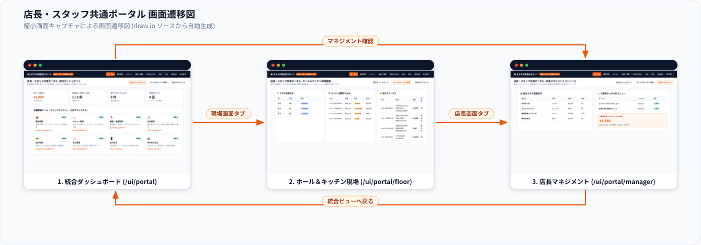

### ポータル代表画面キャプチャ

| 画面 | 機能概要 | キャプチャ |
|---|---|---|
| **1. 統合ダッシュボード** (`/ui/portal`) | 売上累計・稼働座席数・調理中注文件数・登録商品数と全8サブシステムの稼働状態およびクイックランチャーを表示 | 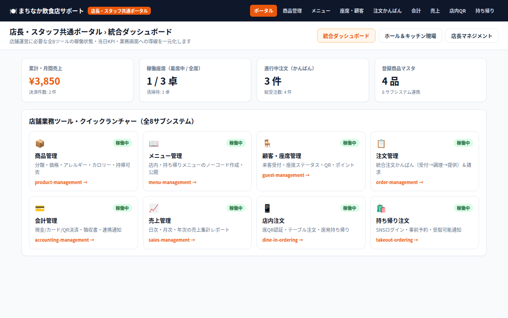 |
| **2. ホール＆キッチン現場** (`/ui/portal/floor`) | フロア座席状況・キッチン調理かんばん・会計ステータスを1画面で横断監視 | 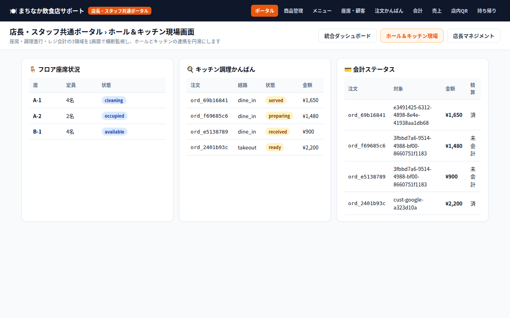 |
| **3. 店長マネジメント** (`/ui/portal/manager`) | 商品マスタ登録状況・チャネル別公開メニュー・年間累計売上を統合管理 | 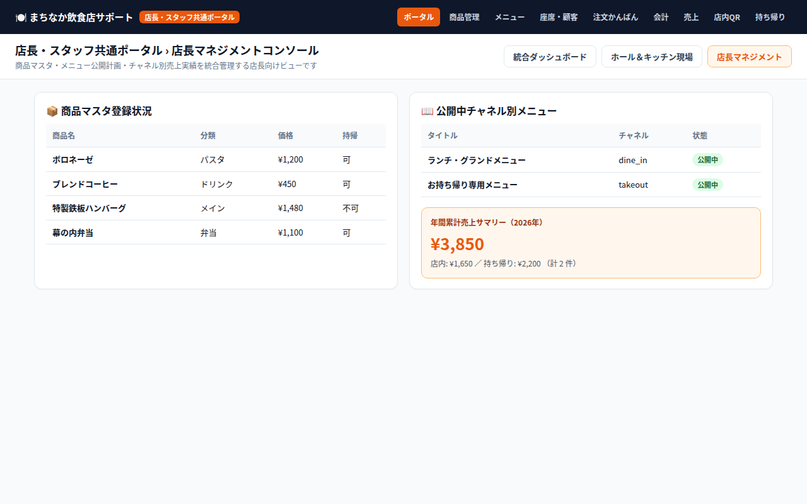 |

---

## 各サブシステムの機能イメージ一覧

各プロジェクトの代表機能キャプチャおよび縮小キャプチャ入り画面遷移図です。より詳細な画面遷移と3画面ごとの機能イメージは各サブシステムリポジトリの `README.md`（および `docs/images/<subsystem>/`）を参照してください。

| サブシステム | 役割・主な機能 | 代表機能キャプチャ | 画面遷移図 |
|---|---|---|---|
| **product-management**<br>（商品管理） | 商品分類・正本価格・アレルギー・カロリー・提供時間・持帰可否の管理 | 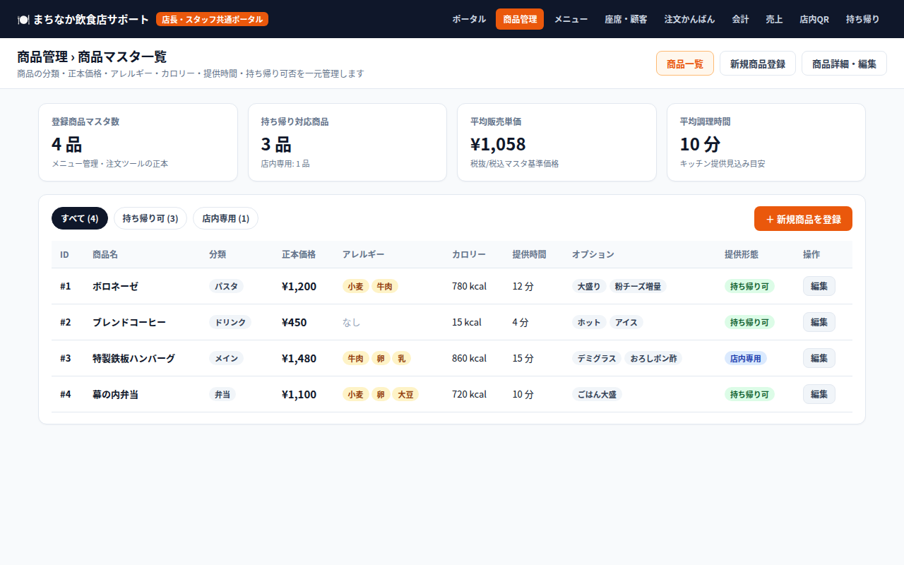 | [遷移図 (SVG)](docs/images/product_management/transition.svg) / [draw.io](docs/images/product_management/transition.drawio) |
| **menu-management**<br>（メニュー管理） | 商品マスタ参照による店内・持ち帰りメニューのノーコード作成・公開切替・端末プレビュー | 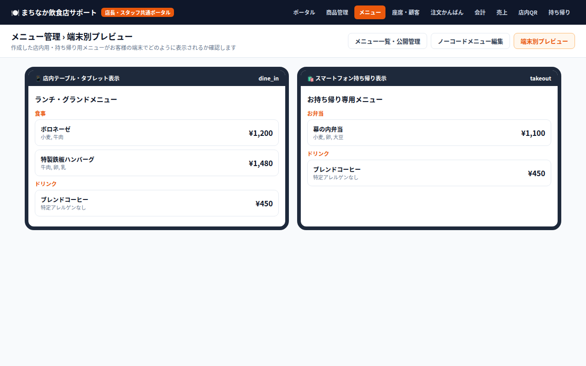 | [遷移図 (SVG)](docs/images/menu_management/transition.svg) / [draw.io](docs/images/menu_management/transition.drawio) |
| **guest-management**<br>（顧客・座席管理） | 空席/着席/清掃中の座席マップ、来客受付と席QRトークン発行、会員ポイント・席再利用 | 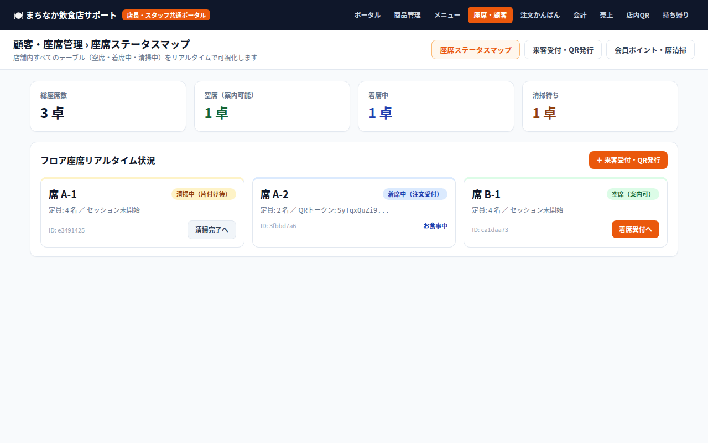 | [遷移図 (SVG)](docs/images/guest_management/transition.svg) / [draw.io](docs/images/guest_management/transition.drawio) |
| **dine-in-ordering**<br>（店内注文） | 席QRセッション認証、店内飲食および席発持ち帰り注文の送信、調理状況確認 | 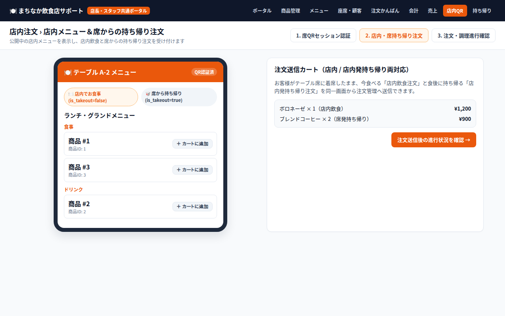 | [遷移図 (SVG)](docs/images/dine_in_ordering/transition.svg) / [draw.io](docs/images/dine_in_ordering/transition.drawio) |
| **takeout-ordering**<br>（持ち帰り注文） | Google/Facebook/LINE SNSログイン、持ち帰り予約、受取可能通知 | 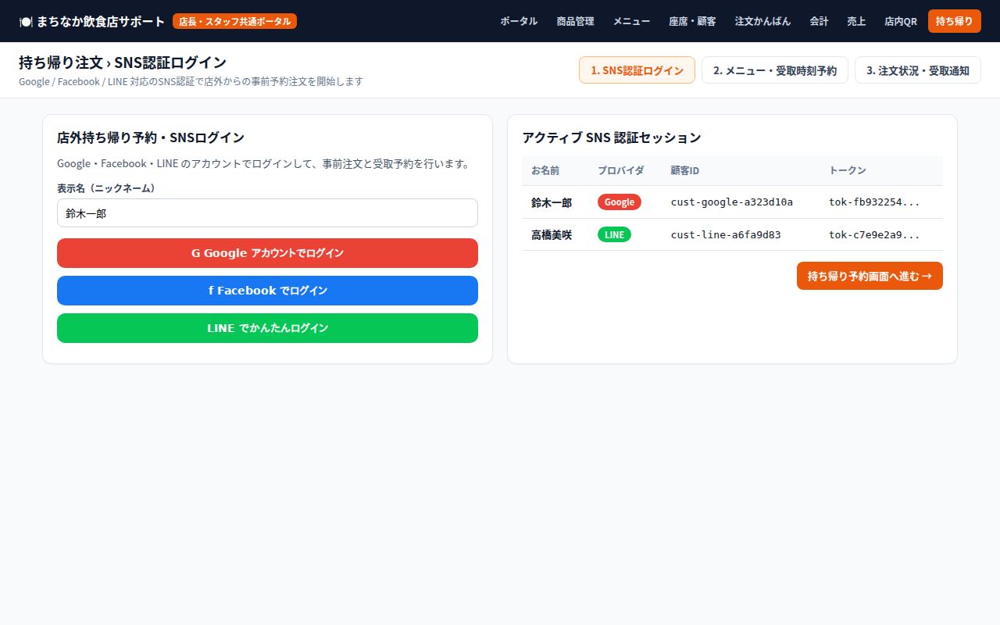 | [遷移図 (SVG)](docs/images/takeout_ordering/transition.svg) / [draw.io](docs/images/takeout_ordering/transition.drawio) |
| **order-management**<br>（注文管理） | 店内・持ち帰り統合注文かんばん（受付→調理中→提供可能→完了）と席別請求額算出 | 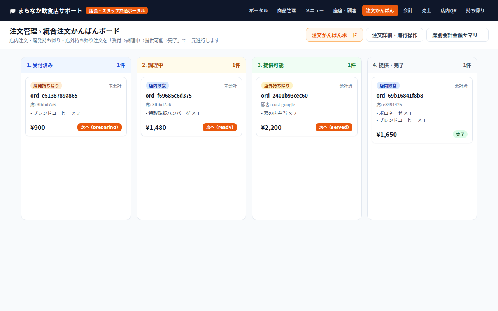 | [遷移図 (SVG)](docs/images/order_management/transition.svg) / [draw.io](docs/images/order_management/transition.drawio) |
| **accounting-management**<br>（会計管理） | 現金/カード/QR決済、お釣り計算、領収書発行、席清掃要求・売上供給連携 | 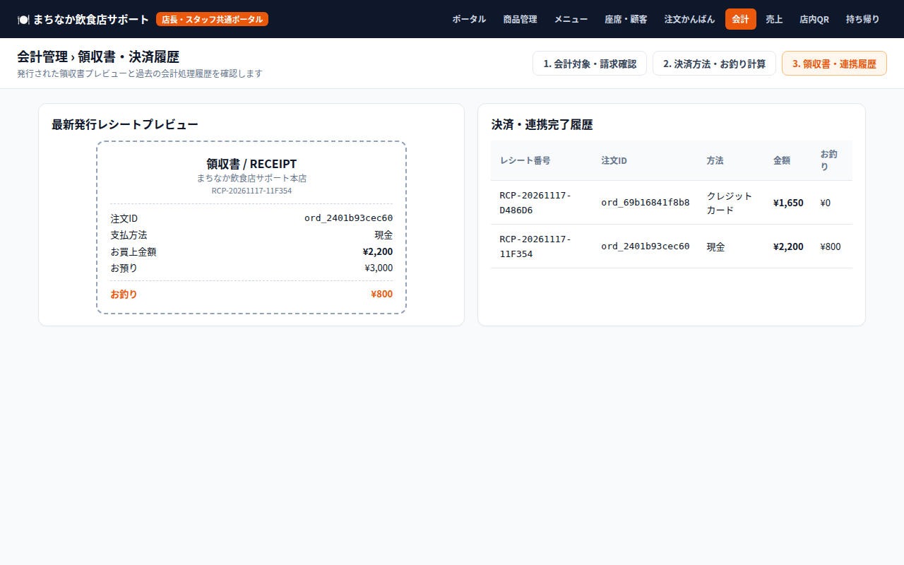 | [遷移図 (SVG)](docs/images/accounting_management/transition.svg) / [draw.io](docs/images/accounting_management/transition.drawio) |
| **sales-management**<br>（売上管理） | 日次・月次・年次の売上集計、店内/持ち帰りチャネル構成比、売上計上明細 | 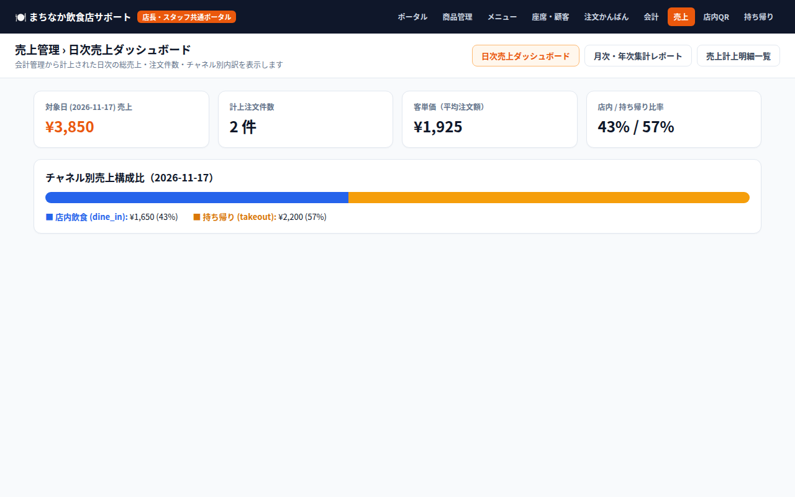 | [遷移図 (SVG)](docs/images/sales_management/transition.svg) / [draw.io](docs/images/sales_management/transition.drawio) |

---

## E2Eテスト連動による画像・画面遷移図の自動反映

E2E総合テスト（[`tests/e2e/test_restaurant_e2e.py`](tests/e2e/test_restaurant_e2e.py)）の最終ステップ `test_e2e_zzz_capture_portal_and_subsystem_screens` にて、全8サブシステムに実業務データを投入した状態で以下を自動実行します（[`src/system_integration/doc_artifacts.py`](src/system_integration/doc_artifacts.py)）。

1. **変更検知とスクリーンショット撮影**: ポータルおよび全8サブシステムの全27画面のHTMLを取得し、前回撮影時（`docs/images/.capture-hashes.json`）からUIや機能出力に変化がある場合、または画像が未生成の場合に Headless Chromium で `1280×800` PNG を自動再撮影します。
2. **draw.io → SVG 自動生成**: 撮影した3画面の PNG を縮小サムネイル化して `transition.drawio`（mxGraphModel XML）を生成し、続けて矢印・遷移ラベル付きの `transition.svg` へ自動変換します。
3. **サブモジュールへの反映**: 生成・更新された `docs/images/` を隣接する各サブシステムの `reference/system-integration/docs/images/` へ自動同期します。

### テスト・ドキュメント画像再生成コマンド

```bash
# 通常の結合テスト・E2Eテスト（UIに変更があるプロジェクトのみ自動で画像と遷移図を更新）
../.venv/bin/python3 -m pytest -v

# UI変更の有無にかかわらず全27画面と9遷移図を強制再生成する場合
FORCE_DOC_CAPTURE=1 ../.venv/bin/python3 -m pytest -v

# 静的解析
../.venv/bin/ruff check .
```
