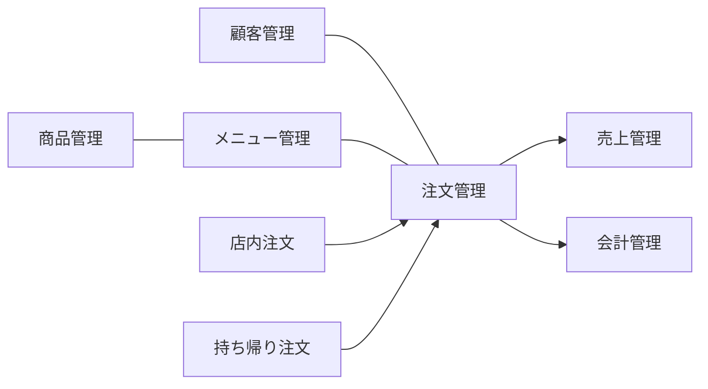

# 全体システム設計（MachinakaRestaurantSupportTools）

ステータス: **ドラフト** — 各章は openspec の変更（change）を通じて更新する。

## 1. システム概要

MachinakaRestaurantSupportTools は、飲食店の業務をデジタル化するツール群の総称である。
各サブシステム（ツール）は独立したリポジトリ・リリース単位で開発されるが、
共通の顧客・メニュー・注文データを介して連携する。

## 2. サブシステム一覧

| サブシステム | リポジトリ | 責任範囲 | USDM 仕様 |
|---|---|---|---|
| 会計管理 | accounting-management | 売上計上、決済、帳票 | `usdm/accounting_management/` |
| 店内注文 | dine-in-ordering | 着席注文、厨房指示 | `usdm/dine_in_ordering/` |
| 顧客管理 | guest-management | 顧客情報、ポイント、予約 | `usdm/guest_management/` |
| メニュー管理 | menu-management | メニュー・価格・在庫の master 管理 | `usdm/menu_management/` |
| 注文管理 | order-management | 注文の共通ドメイン（店内/持ち帰りの統合モデル） | `usdm/order_management/` |
| 商品管理 | product-management | 商品マスタ、原材料、原価 | `usdm/product_management/` |
| 売上管理 | sales-management | 集計・レポート・分析 | `usdm/sales_management/` |
| 持ち帰り注文 | takeout-ordering | 事前注文・受渡し | `usdm/takeout_ordering/` |

## 3. アーキテクチャ

（未定 — change を起案して決定する。候補: 共通基盤＋API ゲートウェイ／イベントバス）

- 全体・各サブシステムの要求の正本は上記 USDM Markdown（Excel は生成物、非コミット）
- 構成図・シーケンス図はこの章に Mermaid で管理する

## 4. 連携ポイント（結合試験の範囲）

| # | 連携 | 内容 | 備考 |
|---|---|---|---|
| I-1 | 店内注文 → 注文管理 | 注文作成・更新イベント | 未確定 |
| I-2 | 持ち帰り注文 → 注文管理 | 事前注文の受領 | 未確定 |
| I-3 | 注文管理 → 会計管理 | 決済リクエスト | 未確定 |
| I-4 | 注文管理 → 売上管理 | 売上データ供給 | 未確定 |
| I-5 | メニュー/商品管理 → 各注文ツール | master 参照 | 未確定 |
| I-6 | 顧客管理 → 会計/注文 | 会員認証・ポイント | 未確定 |

## 5. 非機能要件（全体）

（USDM の全体プロジェクト `usdm/machinaka_restaurant_support_tools/` と整合させる。未確定）

## 6. テスト戦略

| レベル | 実施場所 | 範囲 |
|---|---|---|
| 単体試験 | 各サブシステムリポジトリ | WHEN/THEN 詳細設計に基づく各モジュール |
| 結合試験 | system-integration | 上記 4 章の連携ポイント I-1〜I-n |
| 総合試験 | system-integration | 全体 USDM の上位要求シナリオ（E2E） |

## 7. ブランチ・リリース運用

- 全リポジトリ: `main` は保護。作業ブランチは `feature/<change-id>`（openspec の change ID で全リポジトリ共通）
- system-integration: `opsx:propose` 時に最初に feature ブランチを作成。`opsx:archive` で各サブシステムの単体試験状況を確認し、**結合試験・総合試験が完了するまで main にマージしない**。完了後に PR 作成、マージ時はファイル一覧の更新（各サブシステム側の submodule 参照コミット更新）
- サブシステム: system-integration の feature ブランチに合わせて `feature/<change-id>` を作成し、submodule（`reference/system-integration/`）の参照先ブランチも同名へ切り替える。実装〜単体試験完了で自分の main へ PR。PR マージ時にファイル一覧の更新・submodule 参照ブランチを main に戻す
- system-integration の仕様・設計は各サブシステムでは git submodule（`reference/system-integration`）として参照（読み取り専用）
