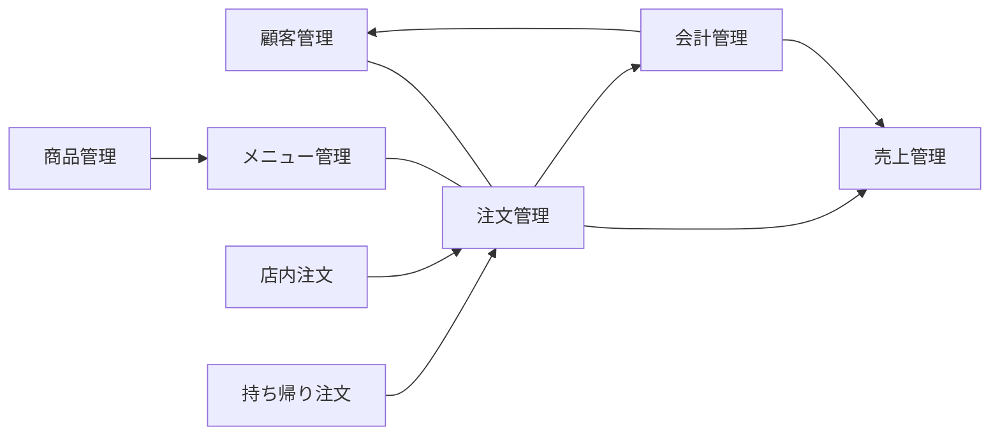

# 全体システム設計（MachinakaRestaurantSupportTools）

ステータス: **確定（MVP v1.0）** — `init` 変更を通じて更新。

## 1. システム概要

MachinakaRestaurantSupportTools は、飲食店の業務をデジタル化するツール群の総称である。
各サブシステム（ツール）は独立したリポジトリ・リリース単位で開発されるが、
共通の顧客・メニュー・注文・会計・売上データを介して HTTP/JSON API で連携する。

## 2. サブシステム一覧

| サブシステム | リポジトリ | 責任範囲 | USDM 仕様 |
|---|---|---|---|
| 会計管理 | accounting-management | 売上計上、決済、帳票、席状態連携 | `usdm/accounting_management/` |
| 店内注文 | dine-in-ordering | 着席注文（QR）、店内からの持ち帰り注文 | `usdm/dine_in_ordering/` |
| 顧客管理 | guest-management | 座席状況、来客受付、再利用可否、会員ポイント | `usdm/guest_management/` |
| メニュー管理 | menu-management | 店内・持ち帰りメニューの作成・公開管理 | `usdm/menu_management/` |
| 注文管理 | order-management | 注文の共通ドメイン、かんばん進行、会計金額算出 | `usdm/order_management/` |
| 商品管理 | product-management | 商品マスタ、アレルギー、カロリー、提供時間、原価・持ち帰り可否 | `usdm/product_management/` |
| 売上管理 | sales-management | 日次・月次・年次売上集計・レポート | `usdm/sales_management/` |
| 持ち帰り注文 | takeout-ordering | SNS認証、事前注文、受取予約、状況確認、通知 | `usdm/takeout_ordering/` |

## 3. アーキテクチャ

- **技術スタック**: 全8サブシステム共通で **Python 3.12 + FastAPI + Pydantic v2 + httpx + pytest + ruff** を採用する。
- **サービス間通信**: REST/JSON（`httpx.Client`）。結合試験では `httpx.ASGITransport` を用いたインプロセス接続で疎結合に検証可能とする。
- **共通規約**: 全サブシステムは `GET /health`（`{"status": "ok", "service": "<name>"}`）を公開する。
- 全体・各サブシステムの要求の正本は上記 USDM Markdown（Excel は生成物、非コミット）。

## 4. 連携ポイント（結合試験の範囲）

| # | 連携 | 内容 | エンドポイント / 契約 |
|---|---|---|---|
| I-1 | 店内注文 → 注文管理 | 注文作成・更新 | `POST /orders` (`source="dine_in"`) |
| I-2 | 持ち帰り注文 → 注文管理 | 事前注文の受領 | `POST /orders` (`source="takeout"`) |
| I-3 | 注文管理 ↔ 会計管理 | 会計金額参照・決済完了通知 | `GET /orders/{id}` / `POST /orders/{id}/mark-paid` / `POST /payments` |
| I-4 | 会計/注文管理 → 売上管理 | 売上データ供給 | `POST /sales/records` |
| I-5 | 商品/メニュー管理 → 各注文ツール | マスタ・公開メニュー参照 | `GET /products`, `GET /menus/{channel}` |
| I-6 | 顧客管理 ↔ 会計/注文 | 来客受付・席状態更新・ポイント付与 | `POST /tables/{id}/occupy`, `POST /tables/{id}/request-cleaning`, `POST /tables/{id}/release`, `POST /guests/{id}/points` |

## 5. 非機能要件（全体）

- **入力検証**: Pydantic v2 によるスキーマ検証を行い、不正入力には HTTP 422 を返す。
- **状態整合性**: 存在しないリソースは HTTP 404、不正な状態遷移・重複操作は HTTP 409 を返す。
- **テスト性**: 各サービスはインメモリデータストアと `create_app()` ファクトリを備え、外部プロセスやDBなしで単体・結合試験を実行できること。

## 6. テスト戦略

| レベル | 実施場所 | 範囲 |
|---|---|---|
| 単体試験 | 各サブシステムリポジトリ | WHEN/THEN 詳細設計に基づく各モジュール（`pytest`） |
| 結合試験 | `system-integration` | 上記 4 章の連携ポイント I-1〜I-6（`tests/integration/`） |
| 総合試験 | `system-integration` | 全体 USDM の上位要求シナリオ E2E（`tests/e2e/`） |

## 7. ブランチ・リリース運用

- 全リポジトリ: `main` は保護。作業ブランチは `feature/<change-id>`（openspec の change ID で全リポジトリ共通）
- `system-integration`: `opsx:propose` 時に最初に feature ブランチを作成。`opsx:archive` で各サブシステムの単体試験状況を確認し、**結合試験・総合試験が完了するまで main にマージしない**。完了後に PR 作成、マージ時は各サブシステム側の submodule 参照コミット更新
- サブシステム: `system-integration` の feature ブランチに合わせて `feature/<change-id>` を作成し、submodule（`reference/system-integration/`）の参照先ブランチも同名へ切り替える。実装〜単体試験完了で自分の `main` へ PR。PR マージ時にファイル一覧の更新・submodule 参照ブランチを `main` に戻す
- `system-integration` の仕様・設計は各サブシステムでは git submodule（`reference/system-integration`）として参照（読み取り専用）
